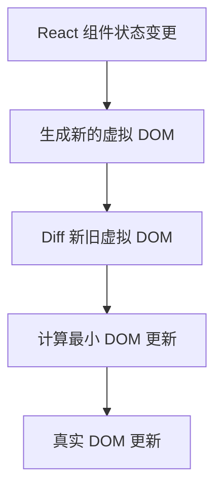
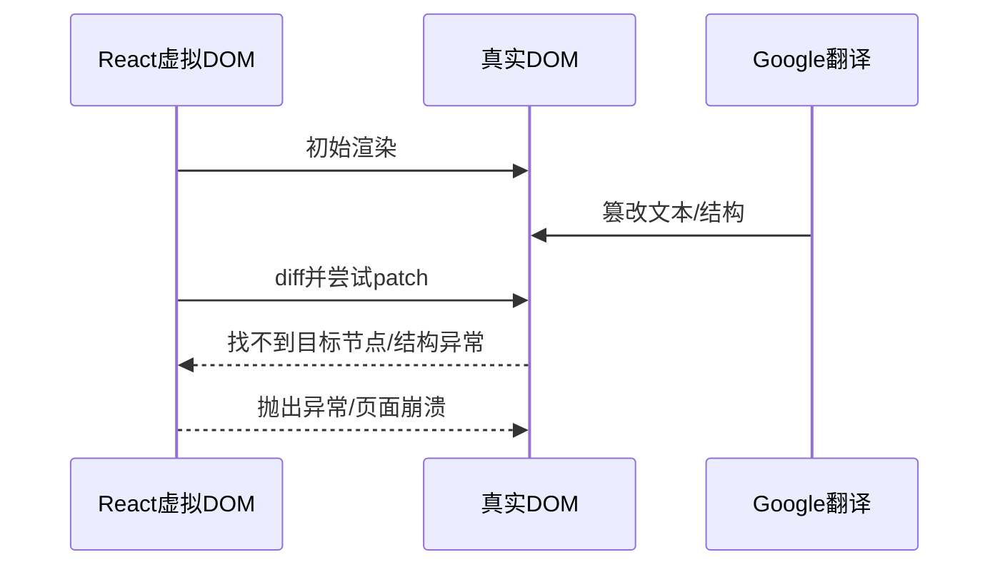
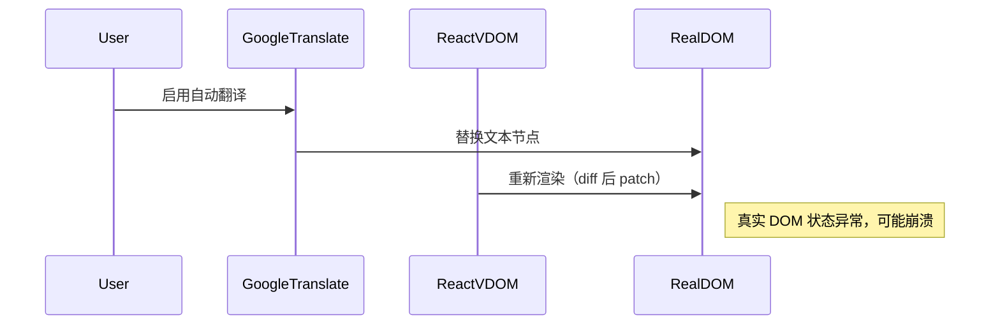

# 为什么开了 Google 自动翻译系统会导致 React 应用崩溃

## 现象描述
在某些 React 应用中，用户开启浏览器的 Google Translate 自动翻译功能后，页面会出现崩溃、白屏、按钮失效等异常现象。这一问题在 Chromium 内核的浏览器（如 Chrome、Edge）上尤为突出。

## 相关参考
- [Everything about Google Translate crashing React](https://martijnhols.nl/blog/everything-about-google-translate-crashing-react)
- [Chromium 官方 issue 41407169](https://issues.chromium.org/issues/41407169)

## React 虚拟 DOM 原理简述
React 通过虚拟 DOM（Virtual DOM）维护 UI 状态。每次组件状态变化时，React 会重新渲染虚拟 DOM，并与上一次的虚拟 DOM 进行 diff，然后通过最小化的 DOM 操作同步到真实 DOM。



## 虚拟DOM与Diff算法详解

### 虚拟DOM基本概念
虚拟DOM（Virtual DOM）是React等现代前端框架用来描述UI结构的一种轻量级JavaScript对象。每次组件状态发生变化，React会生成一棵新的虚拟DOM树，然后与上一次的虚拟DOM树进行对比（diff），最终将差异最小化地同步到真实DOM。

### Diff算法核心流程
React的diff算法遵循以下原则：
1. **同级比较**：只会对同一层级的节点进行比较，不会跨层级移动节点。
2. **Key优化**：对于列表结构，通过`key`属性快速定位节点，提高diff效率。
3. **类型判断**：如果节点类型不同，直接销毁旧节点并创建新节点。
4. **递归对子节点进行diff**。

#### Diff过程伪代码示意
```js
function diff(oldVNode, newVNode, parentDOM) {
  if (!oldVNode) {
    // 新节点，直接插入
    parentDOM.appendChild(createDOM(newVNode));
  } else if (!newVNode) {
    // 旧节点被删除
    parentDOM.removeChild(oldVNode.dom);
  } else if (oldVNode.type !== newVNode.type) {
    // 节点类型不同，替换
    parentDOM.replaceChild(createDOM(newVNode), oldVNode.dom);
  } else {
    // 类型相同，递归对比属性和子节点
    updateProps(oldVNode.dom, oldVNode.props, newVNode.props);
    diffChildren(oldVNode.children, newVNode.children, oldVNode.dom);
  }
}
```

### Diff与真实DOM同步的本质
- React通过虚拟DOM树的diff，计算出最小的真实DOM操作（增、删、改、移）。
- 这些操作假设“真实DOM和虚拟DOM是一致的”。
- 一旦真实DOM被外部（如Google Translate）篡改，diff算法的假设被破坏。

### Google Translate干扰下的diff崩溃场景（详细说明与例子）

复现demo：https://stackblitz.com/edit/vitejs-vite-uxxhqmd2?file=src%2FApp.tsx&terminal=dev

#### 1. Google Translate 如何篡改真实DOM
Google Translate 的自动翻译会直接遍历页面所有文本节点，将其内容替换为翻译后的文本。例如：
- 原始按钮：`<p>click: {isClick && 'true'}</p>`
- 渲染后：`<p>"click: ""true"</p>`
- 翻译后：`<p><font style="vertical-align: inherit;"><font style="vertical-align: inherit;">点击：</font></font><font style="vertical-align: inherit;"><font style="vertical-align: inherit;">真</font></font></p>`

这种替换是直接操作真实DOM，不会通知React，也不会改变虚拟DOM。

#### 2. diff伪代码下的异常流程

**isClick为true的时候**，虚拟DOM结构为

```js
{
  ele: p,
	child: ["click: ", "true"]
}
```

**isClick为false的时候**，虚拟DOM结构为

```js
{
  ele: p,
  child: ["click: "]
}
```

**Diff** 

Ele 同为 p，dom不做改变

child的0，同为【click：】不做改变

child的1，old 为 true，new 为 undefined，旧的删除，所以应该 p.removeChild('true')

**but 真实dom结构为**

```js
{
  ele: p,
  child: [
    {
      ele: font,
      child: [{ele: font,child: ["点击"]}]
    },
    {
      ele: font,
      child: [{ele: font,child: ["真"]}]
    }
  ]
}
```

所以当从p.removeChild('true')，就会得到 true 不是 p 的子节点，然后崩溃

#### 假设前文伪代码：

```js
function diff(oldVNode, newVNode, parentDOM) {
  // ...
  else if (!newVNode) {
    // 旧节点被删除
    parentDOM.removeChild(oldVNode.dom);
  }
  // ...
}
```
在Google Translate修改了真实DOM后，`oldVNode.dom`指向的节点内容已经被替换，甚至节点结构也可能被改变。
- React尝试执行`parentDOM.replaceChild(createDOM(newVNode), oldVNode.dom)`时，`oldVNode.dom`可能已经不是parentDOM的子节点，或者节点类型对不上。
- 这会导致浏览器抛出异常，例如：
  - `NotFoundError: Failed to execute 'replaceChild' on 'Node': The node to be replaced is not a child of this node.`

#### 3. Chromium issue 41407169 实际案例
在[Chromium官方issue 41407169](https://issues.chromium.org/issues/41407169)中，开发者反馈：
- 开启Google Translate后，React页面在更新时崩溃，报错如上。
- 主要原因是Google Translate篡改了DOM，导致React diff时找不到原本节点。

> “Google Translate modifies the DOM, so when React tries to remove or update a node, it can't find it, resulting in a NotFoundError.”

#### 4. 具体例子还原
假设有如下React组件：
```jsx
function Example() {
  const [count, setCount] = React.useState(0);
  return <button onClick={() => setCount(count + 1)}>点击了 {count} 次</button>;
}
```
初始渲染后：
```html
<button>点击了 0 次</button>
```
开启Google Translate后，按钮内容变为：
```html
<button>Clicked 0 times</button>
```
此时点击按钮，React会尝试更新文本为“点击了 1 次”，但它的diff算法依赖于原有节点结构和内容。由于内容被篡改，React在diff时找不到原来的节点，执行`removeChild`或`replaceChild`时就会抛出异常，页面直接崩溃。

#### 5. 流程总结


**核心问题：** React的diff过程假设真实DOM未被外部篡改，而Google Translate直接修改了DOM，导致diff算法失效并引发崩溃。

### 典型崩溃报错示例
```text
Uncaught NotFoundError: Failed to execute 'removeChild' on 'Node': The node to be removed is not a child of this node.
```

### 小结
React的diff算法依赖于虚拟DOM和真实DOM的同步性。Google Translate等外部工具直接修改真实DOM，打破了这一假设，导致diff过程中的节点查找、移除、替换等操作失败，从而引发崩溃。

## Google Translate 的自动翻译机制
Google Translate 自动翻译会直接操作页面上的真实 DOM，将检测到的文本节点替换为翻译后的内容。这种操作是绕过 React 虚拟 DOM 体系的。

- Google Translate 直接修改真实 DOM
- React 依然认为真实 DOM 没有变化
- 下一次 React 重新渲染时，发现真实 DOM 与虚拟 DOM 不一致
- 可能导致节点丢失、事件失效，甚至页面崩溃



## 代码示例
### 问题复现
假设有如下简单的 React 组件：

```jsx
function Example() {
  const [count, setCount] = React.useState(0);
  return (
    <button onClick={() => setCount(count + 1)}>
      点击了 {count} 次
    </button>
  );
}
```

开启 Google Translate 自动翻译后，按钮文本会被替换为英文，例如 "Clicked 0 times"。此时，如果点击按钮，React 会尝试根据虚拟 DOM 更新真实 DOM，但由于内容已被 Google Translate 修改，React 可能找不到原本的节点，导致按钮失效或页面崩溃。

### 相关 Chromium Issue 代码分析
在 [Chromium 官方 issue 41407169](https://issues.chromium.org/issues/41407169) 中，社区和官方均确认这是由于 Google Translate 直接篡改 DOM，破坏了 React 的一致性假设。

## 最佳实践与规避建议
- **避免在敏感业务系统中依赖浏览器自动翻译**，可通过 `notranslate` 类或 `translate="no"` 属性禁止自动翻译：

```html
<body class="notranslate" translate="no">
  <div id="root"></div>
</body>
```
- **重要文本内容建议由后端或前端国际化方案（如 react-intl、i18next）实现多语言**，避免依赖浏览器翻译。
- **对于不可控的第三方页面，建议增加异常监控，及时捕捉和上报页面崩溃信息。**

## 总结
React 依赖虚拟 DOM 与真实 DOM 的一致性。Google Translate 自动翻译直接篡改真实 DOM，破坏了这种一致性，导致 React diff 失败、事件绑定失效，甚至页面崩溃。建议通过禁止自动翻译和前端国际化的方式规避此类问题。